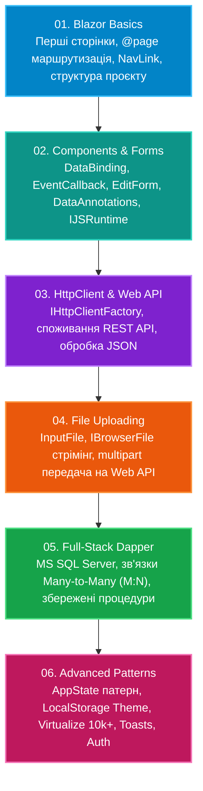

# Blazor Full-Stack Mastery (.NET 10)

[](https://dotnet.microsoft.com/)
[](https://docs.microsoft.com/en-us/dotnet/csharp/)
[](https://dotnet.microsoft.com/apps/aspnet/web-apps/blazor)
[](https://github.com/DapperLib/Dapper)
[](https://github.com/)

Повний практичний курс та посібник з розробки сучасних інтерактивних веб-застосунків на платформі **Blazor** (.NET 10). Охоплює повний цикл навчання: від перших сторінок і компонентів до реактивного керування станом, валідації форм, викликів JS Interop, потокового завантаження файлів, інтеграції з REST API та створення повноцінних Full-Stack рішень з реляційними базами даних (**MS SQL Server + Dapper**).

---

## 🗺️ Дорожня карта курсу (Roadmap)



---

## 📚 Каталог модулів репозиторію

| Модуль | Тематика | Ключові технології | Гілка |
|:---|:---|:---|:---:|
| **[01-Blazor-Basics-FirstApps](01-Blazor-Basics-FirstApps/)** | Основи та старт | `Blazor Server`, `@page`, `NavMenu`, `NavLink`, життєвий цикл першого застосунку | `feat/01-blazor-basics-firstapps` |
| **[02-Components-Forms-Interop](02-Components-Forms-Interop/)** | Компоненти, Форми та JS | `@bind`, `EventCallback`, `<EditForm>`, `DataAnnotationsValidator`, `IJSRuntime`, `Generic Host` | `feat/02-components-forms-interop` |
| **[03-HttpClient-WebApi-Integration](03-HttpClient-WebApi-Integration/)** | Інтеграція з REST API | `HttpClient`, `IHttpClientFactory`, `GetFromJsonAsync`, асинхронне завантаження | `feat/03-httpclient-webapi` |
| **[04-File-Uploading-And-Storage](04-File-Uploading-And-Storage/)** | Завантаження файлів | `<InputFile>`, `IBrowserFile`, `OpenReadStream()`, `MultipartFormDataContent`, `Web API` | `feat/04-file-uploading` |
| **[05-FullStack-Dapper-ManyToMany](05-FullStack-Dapper-ManyToMany/)** | Full-Stack з базою даних | `MS SQL Server`, `Dapper`, зв'язки `Many-to-Many` (M:N), збережені процедури, `database_sql.sql` | `feat/05-fullstack-dapper-database` |
| **[06-Advanced-Patterns](06-Advanced-Patterns/)** | Передові патерни | `AppState Pattern`, `LocalStorage (Dark Mode)`, `<Virtualize>` 10,000+ рядків, `Toast Notifications`, `<AuthorizeView>` | `feat/06-advanced-patterns` |

---

## 🛠️ Вимоги та швидкий старт

- **SDK:** .NET 10.0 SDK або новіший.
- **СУБД:** Microsoft SQL Server (LocalDB / Express / Docker) для модуля 05.
- **IDE:** Visual Studio 2022/2026, JetBrains Rider або VS Code.

```bash
# Клонування репозиторію
git clone https://github.com/MrTomkaYurii/Blazor-FullStack-Mastery.git
cd Blazor-FullStack-Mastery

# Запуск інтерактивного полігону передових патернів
cd 06-Advanced-Patterns/BlazorAdvancedPatterns
dotnet run
```
